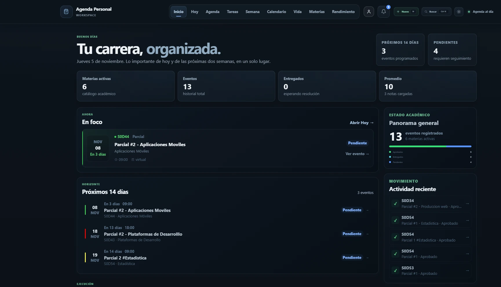
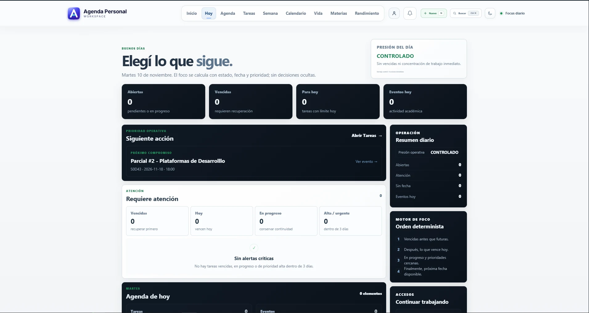
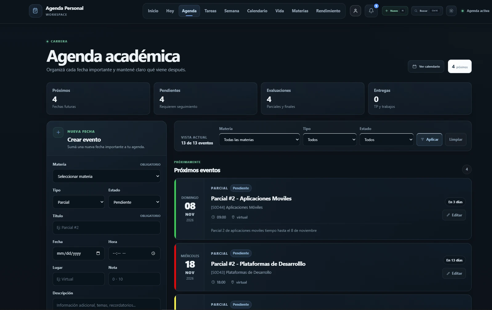
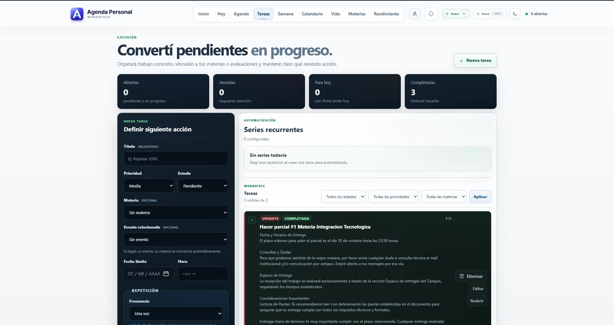
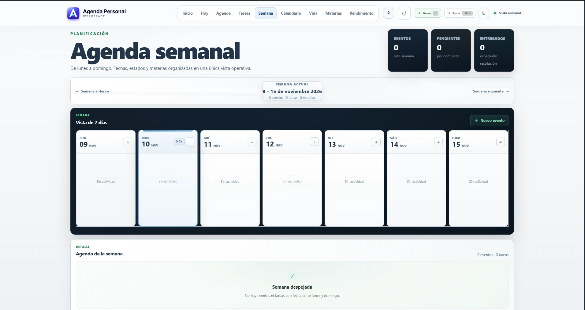
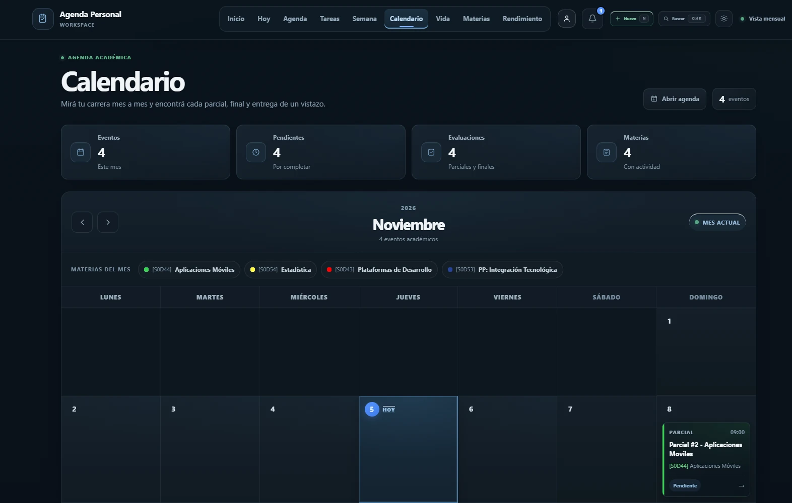
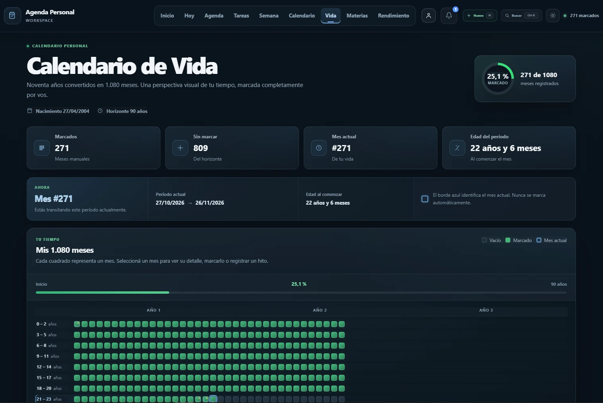
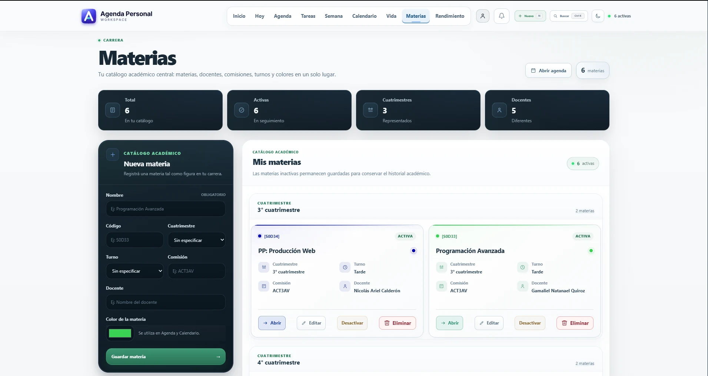
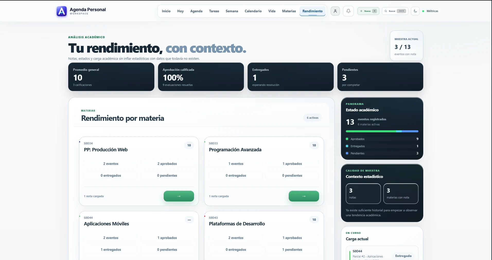

# Galería de capturas · Agenda Personal v11

Estas nueve vistas documentan la interfaz del sistema web multiusuario. Se conserva la resolución de las capturas originales, optimizadas en WebP para un repositorio más liviano.

[Volver al README](../README.md)

---

## 1. Inicio

Panel general con indicadores de materias activas, próximos eventos, pendientes, actividad reciente y seguimiento académico.

## 2. Hoy

Enfoque diario con compromisos prioritarios, estado de tareas y resumen operativo.

## 3. Agenda

Gestión de eventos académicos, fechas de parciales, filtros y estados.

## 4. Tareas

Organización de pendientes, prioridades, recurrencias y tareas completadas.

## 5. Semana

Vista semanal de siete días, actividades y detalle de eventos.

## 6. Calendario

Calendario mensual de eventos, estados y materias identificadas por color.

## 7. Vida

Visualización personal de una línea de tiempo distribuida en 1.080 meses.

## 8. Materias

Catálogo académico, alta de materias y organización por cuatrimestre.

## 9. Rendimiento

Indicadores académicos, resultados por materia y resumen de evaluaciones.

---

> Las capturas pertenecen a una instancia privada. Antes de publicar este repositorio de manera abierta, revisá los datos personales y académicos visibles.
